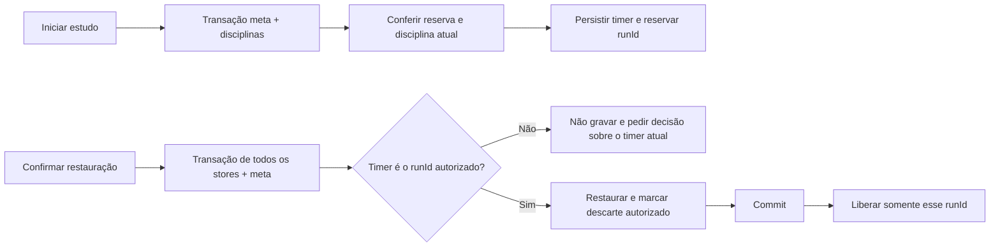

# Integridade e contratos

## Modelo persistido

| Store / chave | Conteúdo e relações |
|---|---|
| areas / id | nome, arquivo e carimbos |
| disciplines / id | área opcional, prioridade, natureza e herança de revisão |
| topics / id | disciplina, ordem, prioridade, agenda e estado derivado de revisão; snooze opcional |
| sessions / id | data civil, minutos líquidos, horários opcionais, breaks, disciplineEntries, topicEntries, types, dificuldade, comentário, results, pausa e Pomodoro opcionais |
| plans / id | plano ativo, meta global, allocations e template de blocos |
| weeklyPlans / id | semana civil, meta histórica, allocations, blocks e rev de concorrência |
| deadlines / id | data, status, prioridade, disciplina/tópico opcionais, notas e orientações |
| settings / key=settings | preferências saneadas; consultas salvas guardam parâmetros, não estatísticas |
| meta / key | migrações, onboarding, último backup e conveniências; activeTimer e lastDiscardedTimer guardam somente identidades de timer |

`diarioEstudosDB` e as chaves legadas foram preservados. Schema lógico 10 e físico 1 continuam iguais. Os dois metadados novos são limitados a uma entrada cada, não um log crescente. O relógio continua em localStorage. Rascunhos são temporários e não entram como sessões nem no backup.

## Invariantes verificadas

- **Identidade:** finalizações concorrentes do mesmo runId produzem uma sessão. `add` e leitura de duplicata estão na transação.
- **Conservação:** 70 + 50 = 120 min, em um estudo. Três tópicos estimados de 90 min somam 90. Dois tipos dividem o mesmo total.
- **Descanso e pausa:** ficam fora de minutos líquidos. Dois blocos 25/5 produzem 50 min de estudo e 5 de descanso. Pausa/descanso congelam estudo após F5.
- **Acerto:** 1/1 + 50/100 = 51/101 ≈ 50,495%; zero questões → percentual indisponível. 60% → 80% = +20 p.p.
- **Atribuição:** resultado sem disciplina específica de sessão múltipla fica no total geral, sem aparecer no recorte de uma matéria.
- **Revisões:** revisão geral não altera tópico; retroativa não empurra a agenda atual para trás; excluir o único estudo limpa o derivado.
- **Períodos:** semana parcial compara os mesmos dias; numerador não inclui registros posteriores a hoje. Datas civis não passam por UTC para decidir o dia.
- **Importação:** erro depois de limpar stores aborta a transação inteira. Schema futuro/ilegível e IDs ambíguos são recusados antes de gravar.
- **Compatibilidade:** V2 com referências de tipos diferentes é normalizada antes de converter; schemas 6/7/9 preservam minutos e resultado da revisão; migração atual é idempotente no fixture.
- **Exportação:** CSV tem uma linha por estudo e protege texto iniciado por fórmula. Aspas, vírgulas, acentos e quebras permanecem dados. Exclusão de textos privados foi testada.

## Fronteira do cronômetro e da restauração

A reserva do IndexedDB também resolve a janela em que uma escrita no localStorage ainda não chegou à outra aba. Finalizar consulta o marcador de descarte dentro da transação. Falha de restauração não confirma o descarte nem remove o timer. Uma reserva só é removida se a identidade coincidir, para não liberar um novo estudo por engano.

## Limites preservados e riscos residuais

O banco usa minutos inteiros: sessões subminuto e arredondamentos não têm precisão de segundos no histórico. Autoavaliações não medem memória. Replay de revisão histórica usa regras documentadas no TopicReconciler, incluindo prioridade atual quando a antiga não existe. Migração testada com fixtures não equivale a verificar todo backup real já produzido.

Storage negado, limpeza manual, encerramento forçado do processo e abas com código antigo continuam exigindo cuidado. Recarregar todas as abas antes de usar a versão alterada faz parte da validação de atualização. Preferências simultâneas ainda são snapshots com última gravação prevalecendo; isso não é o contrato por campo usado nos estudos e entidades.
