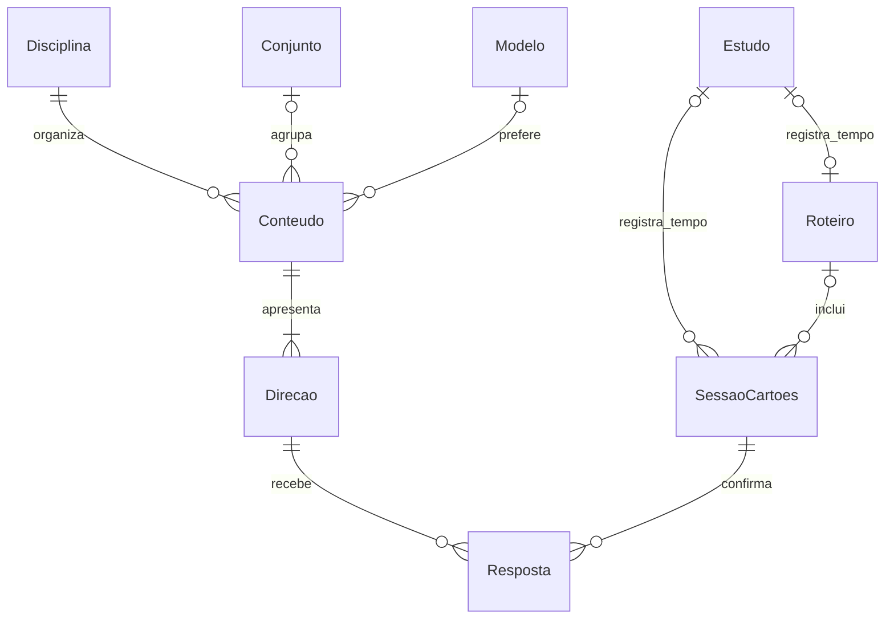

# Revisões e flashcards — contrato da v7.3.0

## Ponto de partida

Inspeção no commit `e7215d8`, v7.2.0, backup lógico 10, IndexedDB físico 1. A suíte original executou **80 testes, todos aprovados**, antes das alterações; o log está em [baseline-tests.txt](baseline-tests.txt).

`ReviewEngine` já resolvia herança global → disciplina → tópico, estratégias adaptativa/fixa/intensiva/manutenção, métodos, prioridades e prazos. `TopicReconciler` já derivava o estado dos tópicos dos estudos; `SessionCommands` já gravava vários tópicos e disciplinas sem multiplicar minutos. Revisão geral não alterava assuntos individuais. `ReviewSuggestions` já adiava sugestões sem alterar a agenda. Esses contratos foram preservados.

O método `flashcards` era apenas um roteiro para cartões externos. Não havia conteúdo de cartão, direção, resposta ou agenda individual persistidos. `buildSession` montava uma proposta não editável e podia ultrapassar o orçamento no primeiro item. A fila `ui.reviewQueue` era volátil e abria uma revisão por assunto.

## Responsabilidades

| Fonte | Responsabilidade |
|---|---|
| `app.js` | IndexedDB, estudos, tópicos, cronômetro, navegação, restauração e integração com Histórico/Análises |
| `flashcards.js` | Tipos, validação, FSRS, comandos de cartões, biblioteca, editor e prática |
| `reviews.js` | Seleção livre multidisciplinar, proposta editável, roteiro durável e gravação agregada |
| `content.js` | Ajuda, biblioteca Como estudar, métodos e novidades |
| `vendor/ts-fsrs-5.2.3.js` | Implementação UMD local de FSRS-6; licença MIT preservada |

Não há framework, backend, IA, conta, telemetria ou dependência de rede durante o uso. Os scripts de domínio são carregados antes de `app.js`, mas seus comandos só acessam os serviços depois da inicialização.

## Persistência e migração

O banco mantém **o mesmo nome legado** `diarioEstudosDB`; a versão física sobe para **2**. O upgrade acrescenta sete stores com `keyPath: id`:

| Store | Conteúdo / índices |
|---|---|
| `flashcardTemplates` | Preferências de tipo, direção, campos e apresentação; nenhum HTML executável |
| `flashcardSets` | Organização opcional, disciplina, arquivo/suspensão, última utilização e revisão |
| `flashcardNotes` | Conteúdo compartilhado, tipo, disciplina, tópico/conjunto/modelo opcionais, direção escolhida e revisão |
| `flashcards` | Uma identidade e um estado FSRS por direção; índice `noteId` |
| `flashcardResponses` | Eventos imutáveis de tentativa; índices `runId` e `cardId` |
| `flashcardRuns` | Fila, cursor, tempo ativo confirmado, modo e vínculo com um único estudo |
| `guidedReviews` | Atividades, resultados explícitos, progresso, tempo ativo e vínculo com um único estudo |

Nenhum estudo, tópico, prioridade, plano ou resultado anterior é convertido por esta versão. O teste de upgrade cria o schema físico 1 e comprova a preservação dos registros na abertura da versão 2. `onversionchange` fecha conexões desta versão e orienta a recarga. Uma aba antiga da v7.2 pode precisar ser fechada para liberar o upgrade.

## Regras que não podem ser quebradas

- Uma direção respondida produz **um evento**; a direção inversa mantém seu estado anterior.
- Revisão geral não responde cartões nem altera a agenda de tópicos.
- Respostas de cartões não aplicam resultados a tópicos. No roteiro, concluir uma atividade de cartões também não atribui resultado ao tópico.
- Uma sessão de 40 minutos continua sendo um estudo de 40 minutos, mesmo com várias disciplinas, tópicos e cartões. Divisões sem informação são estimativas do `SessionModel` existente.
- Pular avança o cursor, sem criar resposta ou resultado de tópico.
- Respostas já confirmadas sobrevivem ao fechamento e ao F5. O tempo de prática recebe checkpoints a cada 10 segundos e nas interações; um encerramento abrupto pode perder os últimos segundos **de tempo**, sem perder respostas confirmadas. O total a registrar é ajustável.
- Fechar ou ocultar a prática pausa a contagem. Não se acrescenta o intervalo em que o aplicativo ficou fechado ao retomar.
- O histórico temporal só é criado por ação explícita. Guardar apenas respostas não acrescenta minutos a Análises.
- Uma atividade de cartões ligada a um roteiro não permite registrar outro estudo separado; o roteiro associa os eventos ao seu estudo agregado.

## Concorrência e falhas

`DB.atomic` lê o estado vigente e grava resposta, agenda e cursor na **mesma transação**. A chave do evento é `runId:posição`; uma repetição devolve o evento existente. Revisões de conteúdo e cartão recusam edições/respostas obsoletas. Exclusão e suspensão são conferidas dentro da transação, inclusive para conjuntos e disciplinas.

O player usa Web Locks para impedir que duas abas, inclusive duplicadas, contem a mesma prática ao mesmo tempo. A reserva é liberada ao fechar ou recarregar a página. Onde Web Locks não existe, uma reserva transacional expira em até 30 segundos. A revisão do roteiro também protege alterações concorrentes de resultados.

Falhas de gravação mantêm o formulário aberto. Não há confirmação visual antes do commit. A suíte injeta uma falha após a escrita de um evento e verifica o rollback conjunto de evento, agenda e cursor.

## Edição, mudança de modelo e exclusões

Editar conteúdo, mover de disciplina/tópico/conjunto ou suspender preserva agenda e respostas. Desativar uma direção a retira da apresentação; reativá-la recupera a identidade e o histórico anteriores. Não há reset silencioso de memória.

O tipo de um conteúdo existente é imutável. **Duplicar em outro modelo** oferece uma cópia com todos os campos; o estudante adapta os campos obrigatórios do novo tipo. O original e seu histórico permanecem. Uma lacuna usa todas as partes ocultas numa única direção, sem criar cartões extras.

Excluir um cartão é uma exclusão lógica explicitada na interface: sai da biblioteca; conteúdo e eventos permanecem no backup. Arquivar permite voltar a estudar. Excluir um conjunto apenas desagrupa os cartões. Excluir uma disciplina remove seus conteúdos da apresentação e desliga as referências à disciplina, preservando os eventos com o nome observado na tentativa. Excluir um estudo remove o vínculo temporal dos cartões e preserva suas respostas.

## Backup e exportação

O contrato lógico sobe para **11**. As sete coleções novas entram nas contagens, prévia, checksum e restauração atômica, junto com as configurações de prática. Reservas de aba são transitórias e ficam fora do arquivo. IDs duplicados, referências incompatíveis, agendas inválidas e respostas que não correspondem ao cursor recusam o arquivo inteiro, com mensagem explícita.

A canonicalização do checksum de formatos até 10 usa exatamente as partes anteriores; backups antigos continuam verificáveis e importáveis. O fixture anual é sintético, exportado pela v7.1.0 com o mesmo contrato lógico 10 da v7.2. O complemento `tests/fixtures/backup-v7.2.json` foi exportado diretamente pelo código original da v7.2.0, mantendo seu checksum. O fixture `tests/fixtures/backup-365.json.gz` não foi alterado: SHA-256 `d7a95eccf03ef484953b48ca0581d656b41f5ceec92c285a0461628f3fa6f2a9`.

O CSV de estudos continua tendo uma linha por estudo. O CSV de respostas tem uma linha por evento e **não contém coluna de minutos**, para não replicar o tempo. Todos os textos passam pelo escape para planilhas, inclusive fórmulas, aspas e quebras de linha. A frente e a resposta no CSV correspondem ao conteúdo atual; ele não representa um snapshot textual de cada tentativa antiga. O JSON é o formato de restauração completo.

## Escolha de agendamento e pesquisa

Foram consultados o [manual do Anki](https://docs.ankiweb.net/deck-options.html#fsrs), a descrição original do [SM-2](https://super-memory.com/english/ol/sm2.htm) e o projeto [ts-fsrs](https://github.com/open-spaced-repetition/ts-fsrs). A escolha foi **FSRS-6 da distribuição ts-fsrs 5.2.3**, fixa e local, em vez de uma aproximação do algoritmo. A versão fixa é deliberada: atualizações do motor exigirão outra revisão e testes, não uma troca por CDN.

Configuração: `request_retention: 0.9`, `maximum_interval: 36500`, `enable_fuzz: false`, `enable_short_term: false`, com os 21 pesos padrão da versão. As opções de passos da biblioteca são preservadas nos parâmetros, mas o agendador de longo prazo foi escolhido; não há repetição intradiária automática obrigatória. Algoritmo, configuração completa, estado anterior, estado posterior e log ficam em cada evento agendado. Prática livre guarda a avaliação e mantém a agenda byte a byte.

Novos cartões usam `createEmptyCard`; cada direção evolui somente com suas próprias avaliações. Não há otimização pessoal de parâmetros nesta release. A retenção desejada é uma entrada do modelo, **não uma afirmação de que o usuário lembra 90%**. Não há gráfico de memória restante nem probabilidade individual exibida. Um vetor fixo verifica novos cartões, dificuldade, lapso e facilidade contra resultados determinísticos da distribuição.

Origem: pacote npm `ts-fsrs@5.2.3`, integridade do tarball registrada pelo npm; arquivo UMD SHA-256 `86d829291cfcca322068f86673697ada4c14b801a5e415e88092e3c8b63c2e9c`. Licença em [`vendor/ts-fsrs-LICENSE`](../../vendor/ts-fsrs-LICENSE). Nenhum código de outro algoritmo foi copiado.

A orientação pedagógica usa [Roediger & Karpicke, 2006](https://doi.org/10.1111/j.1467-9280.2006.01693.x) para recuperação ativa e [Cepeda et al., 2006](https://doi.org/10.1037/0033-2909.132.3.354) para prática distribuída. A interface apresenta princípios e limitações, sem garantir resultados individuais. Flashcards complementam aplicação, exercícios e produção; não substituem essas atividades.

## Limites deliberados

Sem áudio, correção automática de texto, IA, mídia incorporada, importador Anki, HTML livre de modelos, otimização pessoal de pesos ou reversão de uma resposta confirmada. Exemplos são demonstrativos e não gravam resultados fictícios. Modelos personalizados são preferências seguras dos seis formatos, e não esquemas arbitrários. A sequência revela a lista completa; a revelação progressiva é uma evolução possível.

O backup continua sujeito ao limite de 80 MiB já existente no importador. A nova validação limita cada coleção a 200.000 registros e cada campo de conteúdo a 20.000 caracteres, com recusa explícita em vez de truncamento. O histórico visual de um conteúdo mostra as 100 respostas mais recentes; o arquivo JSON preserva todas.
